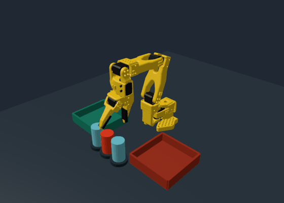

# Browser-independent live runtime benchmarks

See [runtime design and commands](../../docs/wasm-live-runtime.md).

- `gate/`: a joint-driven gate that opens, holds and closes, using `oi.joint-task`.
- `compare.py`: three fresh-process trials per backend and scenario by default.
- `comparison.json`: paced native/WASM comparisons with physics-derived outcomes.
- Rendered reports and GIFs capture the live loop separately from headless timing.

The SO-101 fixtures live in `../native-render/so101/json/` and retain their existing
single-transfer semantics. No scene names or phase names select behavior in the
live host; schemas select reusable capability implementations.

## Recorded results

Validated with MuJoCo 4.0.1, Wasmtime 51.0.0 and native Mesa llvmpipe Vulkan.
The detailed reports identify the CPU, OS, dependency versions and exact input/source hashes.

| Run | Native | WASM |
| --- | ---: | ---: |
| single-can, paced headless | 3/3 passed; 0.997–0.999× | 3/3 passed; 0.997–0.999× |
| five-cans, paced headless | 3/3 passed; 0.992–0.999× | 3/3 passed; 0.999–0.999× |
| blocks, paced headless | 3/3 passed; 0.990–0.999× | 3/3 passed; 0.986–0.999× |
| gate, paced headless | 3/3 passed; 0.994–0.999× | 3/3 passed; 0.989–1.000× |
| SO-101, offscreen, requested 60 FPS | 8.8 FPS; 0.988× | 6.3 FPS; 0.995× |
| SO-101, window, requested 60 FPS | 8.7 FPS; 0.972× | 8.2 FPS; 0.952× |

All 24 headless trials succeeded. Native/WASM sampled qpos values and phase events
matched exactly (maximum measured qpos difference **0.0**). The combined test suite
passed **48 tests**. Both native-window runs produced continuously updated frames.

**Performance acceptance remains open:** the 30 FPS SO-101 target was not met on
this software-rendered environment. Physics stayed close to wall time, but ticks
occasionally exceeded the 2 ms compute budget; inspect the latency and overload
fields. These results do not establish hard real-time scheduling or GPU-desktop
performance. Window validation used a virtual X server over loopback TCP.

The gate live recording independently exercises a mechanism capability:

The SO-101 recording captures actual live physics frames:

Can-placement success uses the preserved benchmark predicate. `no_finger_contact`
is false in these can runs; one finger still touches the supported, settled can.
Full contact separation is therefore not claimed.
