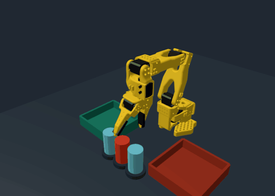

# Native SO-101 contact pick-and-place

The actual pinned SO-101 visual meshes and articulated MuJoCo model pick up a
free can and place it into the green tray. The task is a scripted feedback state
machine using Jacobian IK, position actuators, contact checks and settling checks.
MuJoCo advances the joints and object; pygfx renders the recorded physics poses.
No Chromium, weld/attachment constraint or object-position rewriting is used.

```bash
pip install -e '.[native-render,physics]'
python benchmarks/native-render/so101/run.py
```

This verifies/downloads upstream meshes into ignored `cache/`, runs the task and
a disabled-finger negative test, then writes `pick-and-place.gif` and its evidence
sidecar. Use `--verify-only` to skip rendering, or `--output /tmp/so101.gif`.
Rendering needs a native GPU backend or Mesa software Vulkan as documented in
[`docs/native-render.md`](../../../docs/native-render.md). Physics itself needs
no display or rendering context.



## Verified run

- 9.11 simulated seconds; 137 GIF frames at requested 15 fps (normal speed).
- Bilateral finger contact observed before lift.
- Can center reached 0.08179 m; started near 0.04 m above the workbench.
- Released and settled with receiving-tray contact, within its bounds.
- Final can center approximately `[0.13857, -0.11344, 0.03990]` m in MuJoCo Z-up.
- Zero equality/attachment constraints and zero simulation warnings.
- Disabling both finger collision pads causes an observed grasp failure at
  3.502 seconds; the controller does not report successful placement.

The sidecar records joint/object trajectory samples, phase transitions, final
placement, negative-test results, source lock hash, controller hash and GIF hash.
Frames use the first recorded physics pose at/after their requested time, within
20 ms. Camera framing follows the bounds of all robot/can poses across the run
but remains fixed during playback. The GIF loop restarts the recorded run; it
is not a continuous reset-and-repeat controller.

## Provenance and limits

SO-ARM100 / TheRobotStudio revision
`a758567c3978dfeefe282ede0500085a48fe8f78`, Apache-2.0; see `UPSTREAM-LICENSE`
and `source-lock.json`. Every upstream XML/STL is SHA-256 checked. The controller
is adapted from the user's `isayahc/trace-unseen` workcell at commit
`ff16236ed126293755909d11aa315d747c65a0d5`; this demo stops after its first
verified placement. Two other feed cans and a red tray remain as scene context.

The gripper uses explicit finger-pad collision proxies because convexifying
its concave detailed jaw mesh fills the grasp opening. Pad friction, servo
tuning and object properties are authored simulation assumptions, not calibrated
hardware measurements. The task uses known simulation object state, not vision
or an autonomous agent. Initial arm qpos is set once before the task; subsequent
motion is actuator-driven. The can is never attached to the gripper in software.

`native_mujoco_scene.project_model` projects compiled MuJoCo mesh/primitive
geometry and transforms to OI's portable scene representation. Collision-only
geoms are excluded from display. Floor, table legs and the occluding inspection-camera support are omitted
visually for framing, but remain present in physics. Cylinder/capsule axes and compiled mesh
recentering are covered by geometry-to-world-transform tests.
