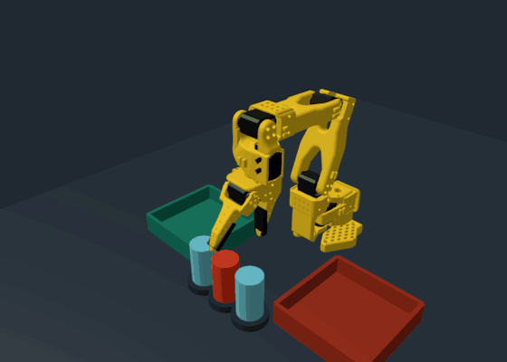

# JSON workcell and task: SO-101 benchmark candidate

This is a separate JSON-driven candidate beside the preserved Python baseline.
The original `../controller.py`, `../run.py` and baseline GIF are unchanged.
The baseline revision is `aff9e1d7b22b8d4ec7ded48b322781c7f00abfab`.

## Run

From the repository root:

```bash
pip install -e '.[native-render,physics]'
python benchmarks/native-render/so101/json/run_json.py
python benchmarks/native-render/so101/json/compare.py
```

`run_json.py --config /path/to/config-directory --output /tmp/json-demo.gif`
loads a different configuration set. `--verify-only` runs physics and records
results without rendering. Relative robot paths resolve against `workcell.json`.
The pinned upstream meshes are verified/downloaded using the existing fetcher.



## What lives in JSON

| File | Authoritative inputs |
| --- | --- |
| `workcell.json` | Pinned robot XML reference/hash, units/axes, physics options, table, trays, walls, free cans, pucks, camera geometry, dimensions, masses, friction and colors |
| `robot-adapter.json` | Robot-specific TCP site, finger contact proxies, collision overrides, actuator force limit and missing-geom naming policy |
| `task.json` | Joint/actuator/site bindings, initial state, IK parameters, named object/destination references, gripper commands, ordered phases, target offsets, dwell/reach conditions, contact/lift/placement checks and recording budgets |
| `render.json` | Image size, fps, camera, looping, room guides and presentation exclusions |
| `cases.json` | Literal JSON Pointer edits for positive/negative cases and predeclared parity tolerances |

The workcell schema is `oi.mujoco-workcell` version 1, the adapter is
`oi.mujoco-adapter`, the task is `oi.pick-place-task`, and the view is
`oi.native-view`. These are explicit PoC contracts, **not** an unversioned change
to OI's existing `astra.scene` format. `world` nodes use typed JSON equivalents
of supported MJCF `body`, `geom`, `joint`, `freejoint`, `site` and `inertial`
elements. Lengths/masses/times/angles use meters/kg/seconds/radians; physics is Z-up.
The visual adapter converts compiled model geometry/poses to OI Y-up.

The initial four files were extracted once from the proven fixture to establish
an equivalent comparison. The new runtime compiles those files independently:
it does not call/import the baseline scene builder, evaluate Python strings,
or choose behavior by hardcoded can, tray or phase names. References and edits
must resolve; typos, unknown phase checks and invalid numeric parameters fail.

Generic Python still implements the algorithms: schema checks, MJCF compilation,
Jacobian IK, phase execution, MuJoCo stepping, physical evaluation and rendering.
The task sequence and all workcell-specific values are authored data. This is a
configured scripted controller, not automatic task planning or vision inference.

## Benchmark result

`comparison.json` records three fresh runs of each version on MuJoCo 4.0.1,
model-field comparisons, tolerances, phase events, metrics and mutation outcomes.
`json-pick-and-place.render.json` contains the candidate trajectory and input/GIF
hashes. The same measurement routine reads `mjData` for both controllers rather
than accepting a commanded pose as proof of success.

| Metric | Python baseline | JSON candidate |
| --- | ---: | ---: |
| Successful runs | 3/3 | 3/3 |
| Completion time | 9.110 s | 9.110 s |
| Maximum can-center height | 0.081789333 m | 0.081789287 m |
| Two-finger contact observed | Yes | Yes |
| Released, supported, contained and settled | Yes | Yes |
| Equality/attachment constraints | 0 | 0 |
| MuJoCo warnings | 0 | 0 |

All compared compiled model arrays, counts, timestep, gravity and integrator
match exactly. Phase names/timings also match exactly. Candidate-vs-baseline
final position difference is **1.93 micrometers**; maximum sampled trajectory
position difference is **5.66 micrometers**. Do not interpret these tiny numerical
differences as measured hardware accuracy or improved performance.

Acceptance tolerances were declared in `cases.json`: 20 ms timing, 2 mm lift
height, 1 mm final position and 2 mm maximum sampled trajectory position error.

## JSON-only variation tests

All six cases passed their expected outcomes:

1. Rename the task object and every phase ID: still succeeds.
2. Shift pickup by 10 mm in the workcell JSON: still succeeds using current object state.
3. Shift receiving-tray geometry and destination/check coordinates by 10 mm: succeeds.
4. Disable finger contacts in adapter JSON: grasp fails, never reports success.
5. Point the task at a nonexistent object: rejected before stepping.
6. Misspell a controller parameter: rejected before stepping.

The unchanged Python baseline also fails the disabled-contact negative test.
The small perturbations demonstrate that configuration affects execution; they
are not a broad generalization benchmark or a claim that every rearrangement is
reachable. Models remain authored simulation assumptions, not hardware calibration.

## Tests

```bash
python benchmarks/native-render/so101/fetch_assets.py
python -m pytest tools/geospatial/test_native_render.py \
  tools/geospatial/test_native_gif.py tools/geospatial/test_native_physics.py \
  tools/geospatial/test_native_mujoco_scene.py tools/geospatial/test_json_workcell.py \
  tools/geospatial/test_export.py -q
```

The combined suite has 32 tests, including rejection of mismatched robot hashes,
missing adapter references, invalid initial joint states and unsupported task checks.
The separate benchmark performs the repeated physics comparisons and mutation cases.
