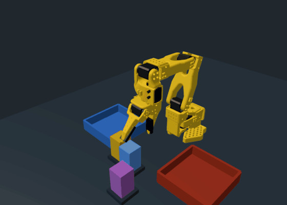

# Block-transfer JSON workcell

Three dynamic rectangular blocks replace the cylindrical cans. The pickup is
shifted 10 mm, the third block has a different staging position, and the blue
receiving tray and destination are shifted 10 mm. Feed supports are rectangular.
The unchanged JSON executor moves block0 and verifies physical contact, lift,
release, tray support and settled placement with MuJoCo.

No Python runtime changes or new robot adapter are required. This exercises
geometry and layout variation within pick-and-place, not arbitrary new skills.

```bash
python benchmarks/native-render/so101/json/run_json.py \
  --config benchmarks/native-render/so101/json/block-transfer \
  --output benchmarks/native-render/so101/json/block-transfer/block-transfer.gif
```


