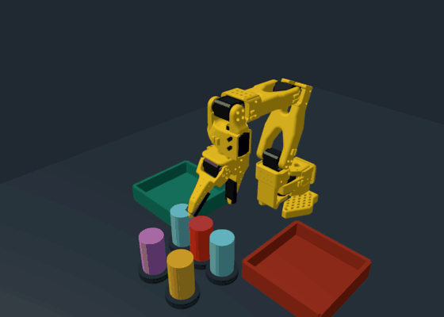

# Five-can JSON workcell

Five dynamic cans (`can0` through `can4`) and their feed pucks are declared in
`workcell.json`. This variant adds two cans to the three-can benchmark scene.
No Python runtime changes are required. The existing task still picks and places
`can0`; the other four cans remain in the scene as simulated objects.

Run from the repository root:

```bash
python benchmarks/native-render/so101/json/run_json.py \
  --config benchmarks/native-render/so101/json/five-cans \
  --output benchmarks/native-render/so101/json/five-cans/five-cans.gif
```


