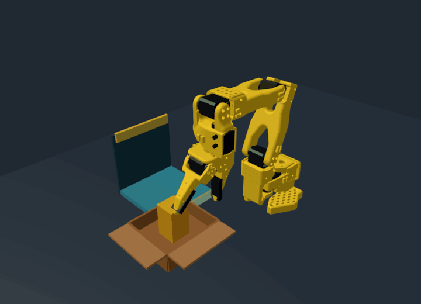

# Unpack to storefront: one simulated instance

An SO-101 removes one boxed retail product from an already-open shipping carton
and places it onto a small storefront display shelf. The carton, open flaps,
display backboard, header and price strip are collision geometry defined in
workcell.json. The product is a free dynamic body. task.json names the unpack,
transfer and stock-display phases; the shared Python executor is unchanged.

Scope: one product, one open carton, one display. Opening tape/flaps, deformable
cardboard, walking or transport between rooms, and customer behavior are not
simulated. This is a tabletop abstraction of unpacking and stocking.

Success requires two-finger contact, lift, release, support by display-shelf,
containment in the destination region and low final object velocity. MuJoCo
advances physics; the renderer replays those measured poses without Chromium.

```bash
python benchmarks/native-render/so101/json/run_json.py \
  --config benchmarks/native-render/so101/json/unpack-to-storefront \
  --output benchmarks/native-render/so101/json/unpack-to-storefront/unpack-to-storefront.gif
```


