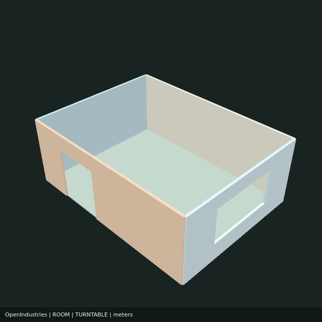

# Backend render evidence for #67

Generated by the real MCP → HTTP service → disposable Chromium worker path with no workbench interaction. The MCP process was closed after submission. The test decoded the completed GIF, downloaded it through a fresh MCP process, restarted the service and retrieved identical media.

- [Portable room scene](one-room.scene.json)
- [Review metadata](one-room.review.json)
- Tested local implementation commit: `d5095e986818a67017e19a3a54bc268e5eebb0ad`. If published through the GitHub Git-data API, the PR records the equivalent implementation tree.
- Renderer build SHA-256: `9f62d8e9dd7bcff68ee61c42da42106d68a6747c7090f65119348fe6bf3ed55d`
- GIF SHA-256: `84e324854b03f7ede41b1dc7bf1bc5e6a69f8c87a430dca06787a1413dc53194`
- Chromium: `140.0.7339.16`; Linux x86-64, Node 24.22.1, SwiftShader. This container explicitly used `OI_RENDER_NO_SANDBOX=1` and its installed headless-shell executable. CI installs Playwright Chromium on Node 22.

## Results

| Check | Result |
| --- | --- |
| `npm run build` | Passed |
| `npm run test:render` | 6 integration tests passed |
| `npm run test:mcp-branding` | 3 tests passed |
| `npm run test:animation` | Passed |
| `npm run test:portable-scenes` | Passed |
| `npm run test:animation-browser` | Passed, including existing UI GIF pixel checks |
| `npm run demo:render` against separate `npm run render:serve` | Passed, completed and downloaded GIF + JSON |
| Manual frame inspection | Frames 0, 15 and 30 show the room, entrance/window and changing camera views |

The decoder verified 640 × 640, 60 frames, indefinite looping, 70 ms per frame (4.2 s actual duration), and more than 500 changed pixels between quarter-turn frames. Additional jobs verified empty-room, authored timeline, isolated sample and custom-camera section renders. Boundary checks cover malformed/missing geometry, invalid settings, authentication/origin refusal, idempotency/conflicts, queued/running cancellation, queue ownership, retention, deadline, Chromium launch failure, corrupt outputs, pinned saved revisions, and abrupt process death without replay.

Reproduce using [the deployment and API guide](../../backend-rendering.md). The fixture builder is `benchmarks/render/build-scene.ts`; `npm run test:render` writes fresh evidence into `deliverables/backend-render`. Output files are generated evidence, not physical assembly validation. Long-running lab/video export remains #15.
