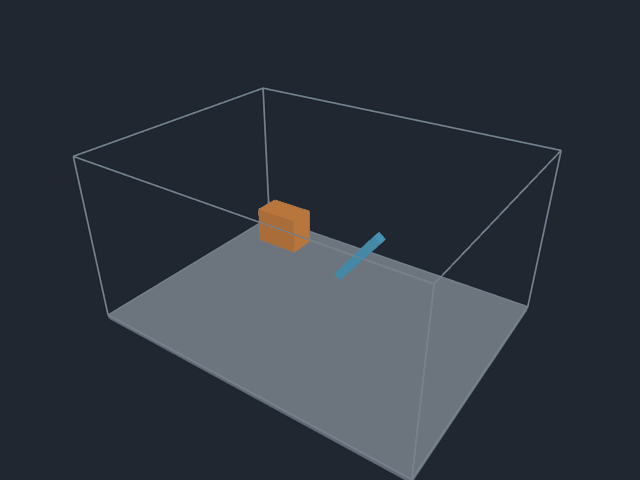

# Native PNG and GIF rendering PoC

Render portable Open-Industries `astra.scene` v1 files with Python, pygfx and
wgpu-native. No Chromium, Playwright, Node service or display server is involved
in rendering or GIF encoding. The existing browser renderer remains unchanged.

## Install and run

```bash
python -m venv .venv
source .venv/bin/activate
pip install -e '.[native-render]'

# Still image
oi-render-scene benchmarks/native-render/room-10x10.oi.json /tmp/room.png

# Four-second camera orbit of the existing field lab's base layout
oi-render-scene benchmarks/field-lab/fixtures/field-lab.oi.json /tmp/orbit.gif \
  --motion turntable --base-layout --duration 4 --fps 15

# Play authored animation with a fixed camera
oi-render-scene benchmarks/field-lab/fixtures/field-lab.oi.json /tmp/animation.gif \
  --motion animation --start 0 --duration 3 --fps 15
```

The output extension selects PNG or GIF. MuJoCo physics GIFs are described below. Common options:
`--width 640 --height 480 --azimuth 35 --elevation 30` (angles in degrees).
GIFs loop by default; `--no-loop` encodes one playback. `--start` selects a time
in the authored timeline or MuJoCo simulation and is valid with `--motion animation`
or `--motion physics`.

On Linux, install a Vulkan-capable GPU driver. On a machine without a GPU,
Mesa's Lavapipe software Vulkan driver works (`sudo apt-get install
mesa-vulkan-drivers` on Debian/Ubuntu). Removing the browser does not remove the
graphics driver dependency. CPU software rendering is not a GPU performance
benchmark. Missing/unsupported drivers fail explicitly.

## Scene and animation contract

- Reuses `export_scene.validate_scene` for exact bundled mesh/source/version
  resolution, including `bundledVersions`. Missing geometry or revision
  mismatches are errors, not placeholder boxes.
- Preserves indexed mesh positions, colors, instance visibility and Three.js
  intrinsic XYZ rotations in degrees. Does not reapply `originOffset`; the
  vertices are already normalized. Shared assets reuse geometry/materials.
- The room tuple is width/depth/height in meters, Y up. A presentation floor and
  wire envelope show the declared dimensions. The extra floor is only added when
  no instances are visible: adding it beneath existing geometry can cause
  coplanar depth flicker (z-fighting). Actual wall geometry must come
  from the bundled assets; the renderer does not infer walls.
- PNGs and turntables show base poses. When tracks exist, `--base-layout` is
  required to explicitly ignore them. Authored GIFs instead require
  `--motion animation`; this conflicts with `--base-layout`.
- Authored animation matches `evaluateWorkspace`/`applyWorldPoses`: linear
  position interpolation, shortest-path quaternion slerp, endpoint clamping,
  held instance visibility (omitted values inherit), and part-local transforms
  about each mesh's bounding-box center before the instance transform.
- Validate targets, duplicate tracks/times, finite poses, timeline bounds and
  visibility before encoding. Missing part targets are errors.
- Authored camera framing covers the sampled motion bounds and remains fixed;
  turntable camera framing stays fixed in scale while orbiting 360 degrees.
  Geometry and the native renderer are created once and updated per frame.
- GIF frame times are quantized to centiseconds with cumulative rounding.
  At 15 fps, delays alternate between 60 and 70 ms rather than truncating every
  frame to 60 ms. The sampled range excludes its end (avoiding a duplicate
  turntable endpoint). Pillow may coalesce identical adjacent frames while
  preserving total duration.
- GIF uses one shared 256-color palette sampled across all frames, without
  dithering. This reduces palette flicker, but color fidelity remains lower than PNG.
- Flat Phong shading converts OI linear RGB to sRGB. This does not promise
  Three.js lighting/shadow/overlay parity. No authored normals or textures,
  automatic physics inference, live scene synchronization or remote asset retrieval.

## Limits and evidence

PNG dimensions: 64–4096 pixels per side. GIF dimensions: 64–1024 pixels per
side; duration: 0.1–12 seconds; fps: 1–50; at most 240 sampled frames and
32 million total frame-pixels. These limits bound the in-memory frame sequence.
Input files are limited to 128 MiB. Browser and cloud import limits are separate. Animation ranges cannot extend beyond the
authored timeline; no implicit wrapping is performed.

Every image gets a `.render.json` sidecar with the native adapter, camera/image
settings, source/output SHA-256 hashes and animation status. GIF reports also
record requested fps, sampled/encoded frame counts, quantized duration, start
time and looping. Files sharing an output stem share a sidecar path.


## Verification

```bash
pip install pytest
pip install -e '.[native-render,physics]'
python -m pytest tools/geospatial/test_native_render.py \
  tools/geospatial/test_native_gif.py tools/geospatial/test_native_physics.py \
  tools/geospatial/test_native_mujoco_scene.py tools/geospatial/test_export.py -q
```

**25 tests passed** on Python 3.12, pygfx 0.18.0, wgpu 0.33.0 and Mesa 25.0.7
Lavapipe (CPU Vulkan). Tests cover geometry/asset bindings, static pixels,
rotation conventions, shortest-path interpolation, part pivots, visibility,
decoded GIF timing/loop settings, changing native frames and invalid ranges.
MuJoCo 4.0.1 tests verify analytical free fall, settled floor contacts, hinge
motion, Z-up/Y-up transforms, missing-body errors and simulation independence
from render sampling frequency.

Rendered examples and adapter/hash sidecars are in
[`benchmarks/native-render`](../benchmarks/native-render).
This host lacked system Vulkan drivers and administrator access, so the matching
Debian Mesa package was extracted temporarily and selected with `VK_DRIVER_FILES`.
No driver binaries or host-specific paths are included in the Python package.
The optional rendering dependencies leave the standard-library exporter intact.

## MuJoCo physics authority

```bash
pip install -e '.[native-render,physics]'
oi-render-scene benchmarks/native-render/physics/scene.oi.json /tmp/physics.gif \
  --motion physics \
  --physics-model benchmarks/native-render/physics/model.xml \
  --physics-bindings benchmarks/native-render/physics/bindings.json \
  --duration 4 --fps 15 --no-loop
```

MuJoCo owns dynamics, contacts, joints, mass/inertia, friction, gravity and
actuation. Pygfx draws the resulting body poses. The included explicit MJCF
models a falling 2 kg box and a hinged 1 kg pendulum with a 2 ms physics step.
These are authored demonstration parameters, not measured real equipment.
The demo's floor collision plane is in MJCF, independently of its OI floor mesh.



Provide your own MJCF and a binding document:

```json
{
  "version": 1,
  "modelUpAxis": "Z",
  "keyframe": "release",
  "controls": {},
  "bindings": [
    {
      "instanceId": "block",
      "body": "falling-block",
      "bodyFromVisual": [
        [1, 0, 0, 0],
        [0, 0, -1, 0],
        [0, 1, 0, -0.4],
        [0, 0, 0, 1]
      ]
    }
  ]
}
```

`bodyFromVisual` is a required rigid 4×4 transform mapping the OI visual's local
Y-up coordinates into the MuJoCo body's local coordinates. In this example,
it accounts for axis conversion and the visual's bottom-origin 0.8 m box.
The adapter applies `Y_FROM_Z × worldFromBody × bodyFromVisual`, then converts
that world pose to the visual's parent frame. An optional `partId` binds a
part rather than a whole instance. Parent bindings are applied first.

`keyframe` optionally initializes the model from a named MJCF keyframe; simulation
time starts at zero. `controls` optionally maps actuator names to constant
controls checked against the model's control limits. This PoC does not yet run
an agent feedback controller or a time-varying control schedule.

Physics uses fixed MuJoCo timesteps, independent of GIF frame rate. Each sample
uses the first physics state at or after its requested time (within one step),
recording actual times. Pose snapshots are computed once, used to fit a stable
camera, then replayed for rendering; the simulation is not advanced a second
time while encoding. MuJoCo warnings/nonfinite states abort export.

Authored OI tracks never drive physics. If they exist, `--base-layout` explicitly
acknowledges replacing them with MuJoCo poses. Unbound visuals remain static and
are not automatically colliders. Arbitrary field-lab/equipment meshes therefore
do **not** become physically validated simply because they can be rendered.
Mass, collision shapes and joints must be authored in the MJCF.

The sidecar records MuJoCo version, timestep, model/binding hashes, bound visual
count, controls, actual sample times, contact counts and final qpos/qvel.
The model hash covers the root XML only, not its external assets/includes.
The existing embodied service remains kinematic; this adds the native export
physics path and does not silently replace that service's controller.

## SO-101 pick-and-place

The [SO-101 demo](../benchmarks/native-render/so101/README.md) runs an actual
contact grasp, lift, transfer, release and verified settling with the pinned
robot meshes. Run `python benchmarks/native-render/so101/run.py` after installing
`.[native-render,physics]`. It includes a negative test with finger contacts
disabled, and uses the native renderer without Chromium.

## JSON-configured workcell and task

The [JSON SO-101 candidate and comparison](../benchmarks/native-render/so101/json/README.md)
loads workcell geometry, robot adaptations, task/control/success criteria and
render settings from four versioned JSON files. It preserves the preceding
Python demo as a benchmark baseline. Run `json/run_json.py` for the candidate
and `json/compare.py` for repeated baseline parity and JSON-only perturbations,
relative to `benchmarks/native-render/so101/`.

## Live execution

For continuously stepped native MuJoCo with standalone WASM control, native window
input, or offscreen live rendering, see [the live runtime](wasm-live-runtime.md).
`oi-live` uses the same JSON fixtures and adds lifecycle controls; it is separate
from the record-then-render GIF path above.
