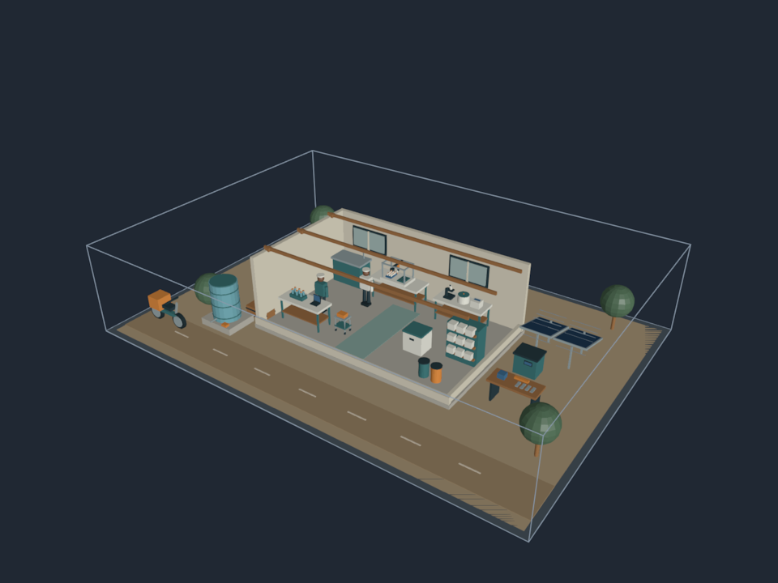

# Native static rendering PoC

Render portable Open-Industries `astra.scene` v1 files to PNG with Python,
pygfx and wgpu-native. No Chromium, Playwright, Node service or display server
is involved in rendering. The existing browser renderer remains unchanged.

## Run from this branch

```bash
python -m venv .venv
source .venv/bin/activate
pip install -e '.[native-render]'
oi-render-scene benchmarks/native-render/room-10x10.oi.json /tmp/room.png
oi-render-scene tools/geospatial/fixtures/open-equipment.oi.json /tmp/equipment.png --base-layout
```

Options: `--width 960 --height 720 --azimuth 35 --elevation 30` (angles in degrees).
The camera fits the visible geometry and room envelope. Images are limited to
64–4096 pixels per dimension. Input is limited to 75 MiB.

On Linux, install a Vulkan-capable GPU driver. On a machine without a GPU,
Mesa's Lavapipe software Vulkan driver works (`sudo apt-get install
mesa-vulkan-drivers` on Debian/Ubuntu). Rendering still needs a graphics driver;
removing the browser does not remove that dependency. No GPU-speed claim is
made for CPU software rendering. Missing/unsupported drivers fail explicitly.

## Contract and scope

- Uses the existing `export_scene.validate_scene` for bundled asset geometry
  and exact source/version resolution, including `bundledVersions`.
- Preserves indexed mesh vertices, part colors, instance visibility and Three.js
  XYZ rotations in degrees. Does not reapply `originOffset`: vertices are already
  normalized. Shared assets reuse GPU geometry/material resources.
- Missing geometry and source revision mismatches are errors, never substitutes.
- The room tuple is width/depth/height, in meters with Y up. It is displayed as
  a presentation floor and wire envelope. These are viewer aids, not authored
  walls. Actual wall meshes must come from the bundled scene assets.
- Static base poses only. Scenes with animation tracks require `--base-layout`
  so ignoring animation is explicit. No frame sampling, part animation, joints,
  physics, textures, live scene synchronization or remote asset retrieval.
- Uses Phong shading with linear-to-sRGB conversion for OI part colors. This is
  not pixel parity with Three.js lighting, shadows or browser overlays.
- Each PNG gets a `.render.json` sidecar with native adapter information,
  camera/image settings, source and output SHA-256 hashes, and static-layout status.

The Python implementation is packaged beside the existing geospatial exporter
so it can reuse the validator and degree-transform implementation without
copying them. Rendering dependencies are optional; the base exporter remains
standard-library-only.

## Verification

```bash
pip install pytest
python -m pytest tools/geospatial/test_native_render.py tools/geospatial/test_export.py -q
```

Tests exercise transforms, normalized mesh positions, colors, visibility,
missing geometry, source revision mismatches, invalid indices, animation
rejection, an empty 10×10 room, and actual native pixels changing when geometry
is hidden. Native tests require a working GPU or software Vulkan driver.

## Recorded PoC run

Verified with Python 3.12, pygfx 0.18.0, wgpu 0.33.0 and Mesa 25.0.7
Lavapipe (CPU Vulkan): **14 tests passed**. Rendered the existing equipment
fixture, the existing field-lab fixture, and the empty 10×10 room. No browser
process is invoked by this code. Mesh shading is flat because the portable
parts provide positions/indices but no authored normals.



The images and hash/adapter sidecars are committed under
[`benchmarks/native-render`](../benchmarks/native-render). Reproduce the larger example:

```bash
oi-render-scene benchmarks/field-lab/fixtures/field-lab.oi.json /tmp/field-lab.png --base-layout
```

This execution host lacked a system Vulkan driver and administrator access.
For verification only, the matching Debian `mesa-vulkan-drivers` package was
extracted to a temporary directory and its Lavapipe ICD selected with
`VK_DRIVER_FILES`. No driver binaries or host-specific paths are part of the
Python package. A normal system driver installation is sufficient.
